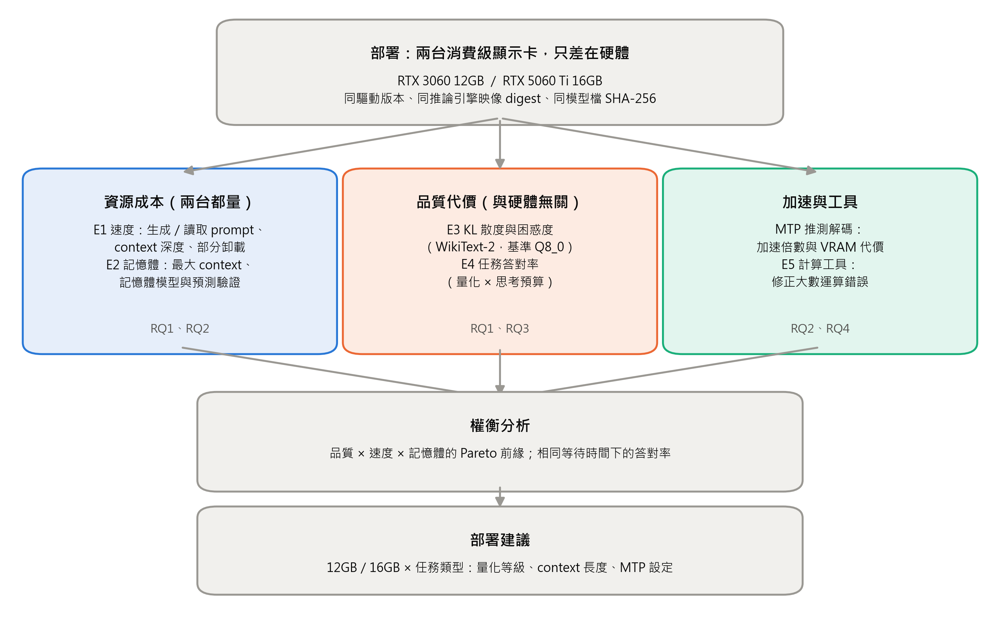

# 二、研究方法、進行步驟及執行進度

## 1. 本計畫採用之研究方法與原因

### 2.1.1 研究架構與主軸

本研究把「VRAM 該花在哪裡」拆成三種互相競爭的資源，分別以獨立的實驗量測，再組合成部署建議（圖 1）：

| 資源 | 增加它的好處 | 增加它的代價 | 對應實驗 |
|---|---|---|---|
| 權重精度（量化位元數） | 輸出更接近原模型 | 權重變大、生成變慢、可用 context 變少 | E1 速度、E2 記憶體、E3 品質 |
| context 容量 | 能處理更長的輸入與更長的思考 | 每個 token 佔用 VRAM | E2 記憶體 |
| 推測解碼（MTP）與思考預算 | 生成更快；同樣時間能想更多 | MTP 佔用 VRAM；思考花時間 | MTP 量測、E4 任務 |

量測分為三層：**資源成本**（記憶體與速度，與硬體有關，兩台機器都量）、**品質代價**（KL 散度與任務答對率，與硬體無關，在一台機器上量），以及**應用驗證**（計算工具）。因為品質與硬體無關，本研究以「品質 × 各硬體的速度與記憶體」組合出每張顯示卡的權衡，不必在每台機器上重複所有品質實驗。這個拆分讓實驗總量維持在學期內可完成的範圍。

本研究在期中前已完成 E1、E2、E3、MTP 量測與 E4 的難度校準，下文各節除說明方法與選擇原因外，也列出這些**初步結果**。所有實測值皆可追溯到原始紀錄；理論推算的數值一律標明「推導值」。

### 2.1.2 實驗環境與控制變數

**硬體。** 兩台機器代表兩個常見的 VRAM 等級（表 1）。

**表 1　實驗機器**

| 項目 | 機器 A（主力機） | 機器 B（伺服器） |
|---|---|---|
| GPU | RTX 5060 Ti 16GB（Blackwell、GDDR7、約 448 GB/s） | RTX 3060 12GB（Ampere、GDDR6、約 360 GB/s） |
| CPU | AMD Ryzen 7 7700（8 核 16 緒） | Intel Core i5-11400F（6 核 12 緒） |
| 系統記憶體 | 64 GB DDR5-6000 | 16 GB DDR4-3600 |
| 作業系統 | Ubuntu 24.04.5（雙系統的 Linux 端） | Ubuntu Server 26.04 |
| 推論時的執行緒數 | 8 | 6 |

**軟體一致性。** 兩台機器的 NVIDIA 驅動同為 595.91.07（open kernel module），推論引擎同為 llama.cpp build 11347（commit 5fc4f3c8c）[19]，並以 Docker 執行。由於映像的 tag 會隨時間更新，本研究以**映像 digest** 固定版本：伺服器映像 `server-cuda13-b11347`（sha256:936e9d2a…）與含測試工具的 `full-cuda13-b11347`（sha256:3f7b5ae4…）。如此兩台機器只差在硬體，比較結果不會混入作業系統或版本的差異。

**模型檔一致性。** 所有量化檔皆從同一個 Hugging Face 版本（revision 4ca72078…）下載 [20]，並以 SHA-256 與發布端紀錄比對；同一個檔案在兩台機器上的雜湊值相同。

**量測條件。** 為了讓結果可重現，本研究固定以下條件：

1. 推論參數：FlashAttention 開啟、KV cache 以 q8_0 儲存、單一請求槽（`-np 1`）
2. GPU 上沒有其他負載：伺服器沒有接螢幕；主力機以系統介面關閉獨顯的螢幕輸出（驅動回報 display active = Disabled）。這項設定是在初步實驗中發現需要的（見 2.2）
3. 速度測試由 llama-bench 每個條件重複 5 次（部分卸載 3 次）並報告平均 ± 標準差；正式量測前先暖機
4. 每秒記錄 GPU 溫度、功耗與時脈，用來排除過熱降頻，並計算每個 token 的能耗
5. 每次實驗都在紀錄表中留下機器、驅動、build、映像 digest、模型雜湊、完整指令與時間

### 2.1.3 模型與架構特性

本研究使用 Qwen3.8-27B [21]，選擇它的原因有三：參數量約 273 億，量化後恰好落在 12GB 與 16GB 顯示卡的邊界附近，最能呈現取捨；授權為 Apache 2.0，可自由使用；並同時具備本研究關心的兩個新特性：混合架構與思考模式。表 2 是從模型檔中讀出的架構參數。

**表 2　Qwen3.8-27B 架構參數（模型檔中繼資料）**

| 項目 | 數值 | 對記憶體與速度的意義 |
|---|---|---|
| 層數 | 64（另有 1 層 MTP 層） | |
| 全注意力層 | 每 4 層 1 層，共 16 層 | 只有這 16 層需要 KV cache |
| 線性遞迴層 | 48 層，狀態大小固定 | 遞迴狀態不隨 context 成長 |
| query head／KV head | 24／4（GQA） | KV cache 再縮小為 1/6 |
| head 維度 | 256 | |
| 隱藏維度／FFN 維度 | 5,120／17,408 | |
| 詞彙量 | 248,320 | KL 散度的基準檔很大（見 2.1.7） |
| 原生 context | 262,144 | |

**混合架構的影響。** 傳統 Transformer 的每一層都要保存 KV cache。本模型只有 16 層全注意力層需要 KV cache，加上 GQA 只保存 4 個 KV head，因此 KV cache 遠小於同規模的傳統模型；其餘 48 層的遞迴狀態大小固定，不論 context 多長都只佔約 150 MiB（實測，見 2.1.5）。這讓「context 長度」在 VRAM 分配中變得相對便宜，是本研究主軸成立的前提。

**思考模式。** 模型預設在回答前先輸出思考內容，聊天模板預設的推理強度為 xhigh；思考長度沒有上限時，單一題目可能思考數萬個 token。推論引擎提供 `--reasoning-budget` 參數，可以把思考限制在指定的 token 數內，用完時強制結束思考並開始作答。RQ3 即以這個參數作為自變數。模型內建的取樣參數為 temperature 1.0、top_p 0.95、top_k 20，本研究不另行覆寫。

**MTP 層。** 模型訓練時附帶一層多 token 預測（MTP）層，可在推論時作為草稿模型做自我推測解碼（見 2.1.8）。

### 2.1.4 量化方法與自變數

**GGUF 與重要性矩陣。** 本研究使用 llama.cpp 的 GGUF 格式。GGUF 的 k-quant 與 i-quant 系列把權重分成小區塊，每塊共用縮放係數，以 2 到 8 位元儲存。量化時可提供一份**重要性矩陣**（imatrix），由校準資料統計各權重對輸出的影響，讓重要的權重保留較多精度；這與 AWQ [6] 依重要性保護權重的想法相近。本研究的量化檔由 Unsloth 製作，使用 496 筆 imatrix 條目、1,251 個校準區塊（模型檔中繼資料）。

**混合精度。** Unsloth Dynamic（檔名中的 UD）不是把所有張量壓成同一種精度，而是依張量重要性分配不同的量化型別。例如標示為 IQ3_XXS 的檔案（名目 3.06 位元），實際包含 q8_0 張量 98 個、iq3_xxs 120 個、iq3_s 106 個、iq4_xs 45 個，以及 iq2、iq1 系列共 82 個，平均為 3.20 位元（實測，模型載入紀錄）。因此本研究以「實際檔案大小」而非「名目位元數」作為權重精度的指標。

**量化等級。** 本研究選擇 5 種量化，涵蓋從 12GB 卡能完整放入、到 16GB 卡也需要部分卸載的範圍，另以 Q8_0 作為品質基準（表 3）。選擇的原則是：每一種都對應一個實際的部署選項，而不是只為了畫出平滑的曲線。

**表 3　量化等級與可放入的 GPU（每參數位元數為推導值＝檔案大小 × 8 ÷ 27,320,697,856）**

| 量化 | 檔案大小 | 每參數位元數 | 12GB 卡 | 16GB 卡 |
|---|---|---|---|---|
| UD-IQ2_XXS | 6.77 GiB | 2.13 | 全部放入 | 全部放入 |
| UD-Q2_K_XL | 9.15 GiB | 2.88 | 全部放入 | 全部放入 |
| UD-IQ3_XXS | 10.18 GiB | 3.20 | 全部放入 | 全部放入 |
| UD-IQ4_XS | 13.27 GiB | 4.17 | 部分卸載（最多 56 層） | 全部放入 |
| UD-Q4_K_XL | 16.35 GiB | 5.14 | 不測試 | 部分卸載（最多 62 層） |
| Q8_0（基準） | 27.05 GiB | 8.51 | — | 僅用於品質基準 |

表中「最多 56／62 層」為 E1 實測的上限（再多一層即配置失敗）。「部分卸載」是把放不下的層留在系統記憶體，由 CPU 計算，代價是速度大幅下降（見 2.1.6）。
