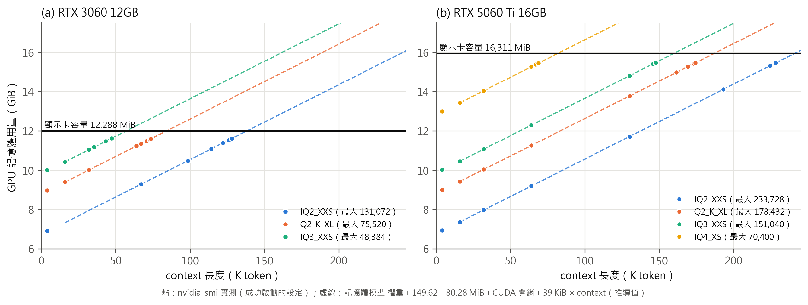
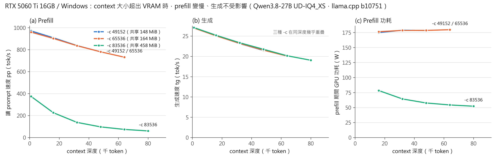
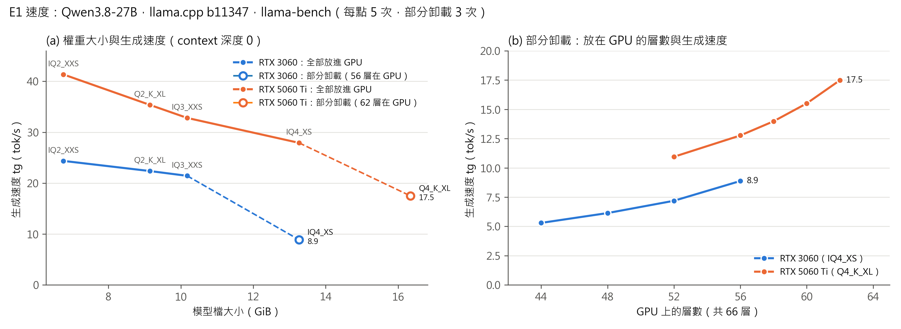
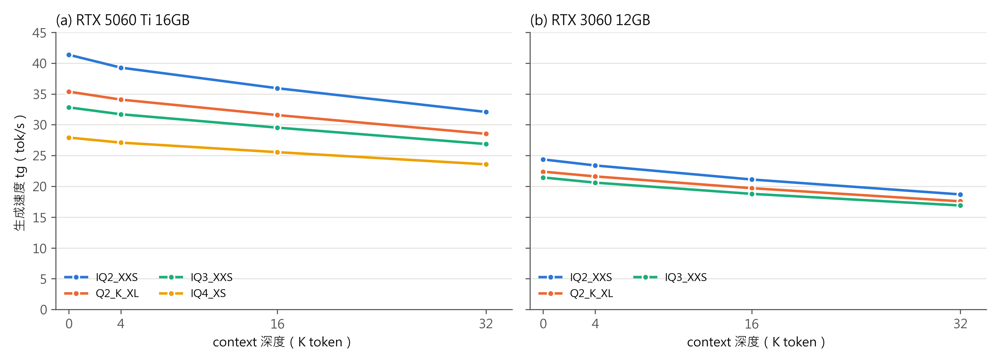

### 2.1.5 記憶體需求模型（E2）

**為什麼需要記憶體模型。** 推論引擎在啟動時一次配置所有記憶體，之後對話變長也不會再增加；放不下時，Linux 上會直接配置失敗。因此「某個設定能不能跑」完全取決於啟動時的配置量。若能用公式事先算出配置量，使用者就不必反覆嘗試。本研究以 `-lv 4` 讓推論引擎在啟動紀錄中列出每一塊記憶體，再與公式比對。

**組成。** 啟動紀錄中 GPU 上的記憶體分為四塊：權重、KV cache、遞迴狀態，以及運算暫存（compute buffer，存放計算中間值）；另有 token embedding 留在系統記憶體（IQ3_XXS 為 397.85 MiB）。表 6 是兩個代表性設定的實測組成。

**表 6　GPU 記憶體組成（實測，MiB；KV 公式值為推導值）**

| 設定 | context | 權重 | KV 實測 | KV 公式 | 遞迴狀態 | 運算暫存 | 四項加總 | nvidia-smi |
|---|---|---|---|---|---|---|---|---|
| 5060 Ti、IQ4_XS | 4,096 | 12,726.35 | 136.0 | 136.0 | 149.62 | 126.28 | 13,138.25 | 13,312 |
| 5060 Ti、IQ4_XS | 16,384 | 12,726.35 | 544.0 | 544.0 | 149.62 | 160.28 | 13,580.25 | 13,754 |
| 5060 Ti、IQ4_XS | 32,768 | 12,726.35 | 1,088.0 | 1,088.0 | 149.62 | 240.28 | 14,204.25 | 14,378 |
| 5060 Ti、IQ4_XS | 65,536 | 12,726.35 | 2,176.0 | 2,176.0 | 149.62 | 400.28 | 15,452.25 | 15,626 |
| 3060、IQ3_XXS | 4,096 | 9,685.21 | 136.0 | 136.0 | 149.62 | 126.28 | 10,097.11 | 10,243 |
| 3060、IQ3_XXS | 16,384 | 9,685.21 | 544.0 | 544.0 | 149.62 | 160.28 | 10,539.11 | 10,685 |
| 3060、IQ3_XXS | 32,768 | 9,685.21 | 1,088.0 | 1,088.0 | 149.62 | 240.28 | 11,163.11 | 11,309 |

**KV cache 公式。** 每個 token 的 KV cache 為：

> 有 KV cache 的層數 × (K 維度 ＋ V 維度) × 每元素位元組數 ＝ 16 × (1,024 ＋ 1,024) × 1.0625 ＝ 34,816 bytes ＝ **34 KiB**

其中 K、V 維度各為 4 個 KV head × 256；q8_0 格式每 32 個元素存 32 個 8 位元整數加 1 個 16 位元縮放係數，即 34 bytes，平均每元素 1.0625 bytes。若把模型當成 64 層全注意力、KV 以 16 位元儲存的傳統 Transformer，同樣的估算會得到 256 KiB，高估約 7.5 倍。

**驗證結果。** 本研究在兩台機器上，對 4 種量化各以多個 context 長度啟動（固定點 4,096、16,384、32,768、65,536，以及二分搜尋過程中的點），共取得 51 組紀錄。結果如下（實測）：

1. **KV cache 與公式完全一致**：51 組的誤差全部為 0.00 MiB
2. **遞迴狀態固定為 149.62 MiB**，與 context 長度和量化等級無關
3. **運算暫存隨 context 線性成長**：context ≥ 16,384 時，各點都落在「80.28 MiB ＋ 5 KiB × context」這條直線上，殘差為 0（此式為本研究由數據擬合，屬推導值；context 4,096 時為 126.28 MiB，高於直線，推測有最低配置量）
4. nvidia-smi 顯示的用量比上述四項加總固定多出一段 CUDA 本身的開銷，RTX 3060 約 146 MiB、RTX 5060 Ti 約 174 MiB

由此得到簡單的記憶體模型（context ≥ 16,384）：

> GPU 用量 ≈ 權重 ＋ 149.62 MiB ＋ 80.28 MiB ＋ CUDA 開銷 ＋ **39 KiB × context**

每多一個 token 的 context 只多用 39 KiB（KV 34 KiB ＋ 運算暫存 5 KiB）。換算下來，1 GiB 的 VRAM 約等於 2.7 萬個 token 的 context（推導值）。

**最大 context。** 本研究以二分搜尋（解析度 1,024 token）找出每種設定在全部放入 GPU 時能啟動的最大 context（表 7）。成功的定義是能啟動、全部的層都在 GPU 上，且能完成一次推論。每次嘗試都重新啟動推論引擎並保存完整的啟動紀錄。

**表 7　全部放入 GPU 時的最大 context（實測）**

| 量化 | RTX 3060 12GB | RTX 5060 Ti 16GB | 最大時的 nvidia-smi（3060／5060 Ti） |
|---|---|---|---|
| UD-IQ2_XXS | 131,072 | 233,728 | 11,889／15,826 MiB |
| UD-Q2_K_XL | 75,520 | 178,432 | 11,883／15,830 MiB |
| UD-IQ3_XXS | 48,384 | 151,040 | 11,905／15,840 MiB |
| UD-IQ4_XS | 放不下 | 70,400 | —／15,812 MiB |

**預測驗證。** 為檢驗模型的實用性，本研究在主力機實驗前，先用 RTX 3060 上歸納出的模型預測 RTX 5060 Ti 跑 IQ4_XS 的最大 context，得到 71,909（推導值）；實測為 70,400，預測高估約 2%。誤差主要來自兩張卡的 CUDA 開銷不同。換言之，使用者只需要知道權重大小與顯示卡可用的記憶體，就能在 2% 左右的誤差內預估可用的 context。

圖 2 把 51 組紀錄中的 nvidia-smi 用量畫在記憶體模型的直線上：context ≥ 16,384 的點都落在線上，各量化的直線斜率相同、只差權重大小造成的平移，因此「換一級量化」在圖上就是整條線上下移動，與顯示卡容量線的交點即為最大 context。另可看出，最大 context 時的用量都比顯示卡容量少約 0.4～0.5 GiB（3060 為 383～405 MiB、5060 Ti 為 471～499 MiB），這段記憶體實際上無法配置給模型（推導值，原因可能是驅動與 CUDA 執行環境的保留量，未確認）。使用記憶體模型估算時，應以「容量減去這段保留量」作為可用上限。

**初步發現（RQ2）。** 表 7 顯示，在 12GB 卡上把量化從 IQ3_XXS 降到 IQ2_XXS，最大 context 從約 4.8 萬增加到 13.1 萬（2.7 倍）；在 16GB 卡上從 IQ4_XS 降到 IQ3_XXS，則從約 7 萬增加到 15 萬。降低權重精度換來的 context 容量非常可觀，但品質代價要配合 2.1.7 一起看。

**作業系統的影響：為什麼正式實驗只在 Linux 上進行。** 本研究在初步實驗中發現，同一張 RTX 5060 Ti、同一個模型檔，在 Windows 上可以用 context 83,536 啟動，在 Linux 上卻配置失敗。兩邊推論引擎估計的需求都是 16,144 MiB，超過可用的 VRAM。差別在於 Windows 的顯示驅動模式允許超量配置，把放不下的部分放到系統記憶體，Linux 則直接回報失敗。為了量化這個現象的代價，本研究在 Windows 上固定其他條件、只改變 context 大小，量測不同 context 深度下的速度與記憶體（表 8、圖 3）。

**表 8　Windows 上超量配置 VRAM 的影響（實測，RTX 5060 Ti、IQ4_XS、llama.cpp build 10751、每點 3 次）**

| context 設定 | 專用／共享記憶體 | 讀取 prompt（深度 1K） | 讀取 prompt（深度 48K） | 生成（深度 1K） | 生成（深度 48K） |
|---|---|---|---|---|---|
| 49,152 | 14,968／148 MiB | 971.0 | 780.6 | 27.04 | 21.47 |
| 65,536 | 15,592／164 MiB | 959.7 | 780.5 | 26.99 | 21.54 |
| 83,536 | 16,008／458 MiB | **374.5** | **97.0** | 27.10 | 21.75 |

結果顯示：超量配置時，**生成速度完全不受影響**（相同深度下差距小於 0.3 tok/s），**讀取 prompt 的速度卻大幅下降**，深度 1K 時只剩 39%，深度 64K 時只剩約 10%（74.2 對 731.6 tok/s）。此時 GPU 使用率顯示 100%，功耗卻只有 52～78 W（正常約 178 W），表示 GPU 大部分時間在等待透過 PCIe 傳來的資料。一般使用者在對話介面上只看得到生成速度，因此很難察覺。這個發現說明「能啟動」不等於「跑得快」，也是本研究正式實驗只在 Linux 上進行的原因：放不下就直接失敗，界線明確，量到的最大 context 才有意義。

**後續工作。** KV cache 精度（16 位元／q8_0／q4_0）也會改變每 token 的成本（推導值分別為 64／34／18 KiB），若時間允許，將以 KL 散度評估它對品質的影響（延伸實驗）。

### 2.1.6 推論效能量測（E1）

**理論：兩個階段受不同的資源限制。** LLM 推論分為兩個階段。**讀取 prompt（prefill）**一次處理數百個 token，每讀一次權重可以做大量運算，速度主要受 GPU 運算能力限制。**生成（decode）**每產生一個 token 都要把全部權重從記憶體讀一遍，運算量相對很少，速度主要受**記憶體頻寬**限制。依 Roofline 模型 [9]，生成速度的理論上限約為「記憶體頻寬 ÷ 權重大小」。因此權重越小，生成應該越快；這是量化除了省記憶體之外的另一個好處。

**方法。** 使用 llama-bench 量測讀取 512 個 token 的速度（pp512）與生成 128 個 token 的速度（tg128），並在 context 深度 0、4,096、16,384、32,768 下各量一次，以觀察 context 變長時的速度變化。每個條件重複 5 次，報告平均與標準差，量測期間每秒記錄 GPU 的溫度、功耗與時脈。部分卸載的設定則從會配置失敗的層數往下掃描放在 GPU 上的層數，每點重複 3 次。另由數據推算兩個衍生指標：**頻寬使用率**（權重大小 × 生成速度 ÷ 理論頻寬，推導值）與**每 token 能耗**（GPU 功耗 ÷ 生成速度，推導值，只含 GPU）。

**表 9　生成速度（tok/s，實測，llama-bench 5 次平均；括號內為頻寬使用率，推導值）**

| 量化 | 5060 Ti 深度 0 | 5060 Ti 深度 32K | 3060 深度 0 | 3060 深度 32K |
|---|---|---|---|---|
| UD-IQ2_XXS | 41.36（67%） | 32.08 | 24.37（49%） | 18.69 |
| UD-Q2_K_XL | 35.38（78%） | 28.53 | 22.38（61%） | 17.57 |
| UD-IQ3_XXS | 32.82（80%） | 26.87 | 21.44（65%） | 16.89 |
| UD-IQ4_XS | 27.92（89%） | 23.57 | 8.88（部分卸載 56 層） | — |
| UD-Q4_K_XL | 17.49（部分卸載 62 層） | — | — | — |

標準差都小於平均值的 1%。

**表 10　讀取 prompt 的速度（pp512，tok/s，實測）**

| 量化 | 5060 Ti 深度 0 | 5060 Ti 深度 32K | 3060 深度 0 | 3060 深度 32K |
|---|---|---|---|---|
| UD-IQ2_XXS | 938.7 | 697.0 | 542.9 | 408.4 |
| UD-Q2_K_XL | 889.4 | 675.3 | 526.3 | 402.8 |
| UD-IQ3_XXS | 919.4 | 692.9 | 526.0 | 408.0 |
| UD-IQ4_XS | 970.1 | 722.1 | 360.6（部分卸載 56 層） | — |

讀取 prompt 的速度與量化等級關係不大（5060 Ti 為 889～970、3060 為 526～543 tok/s），甚至 IQ4_XS 比 IQ2_XXS 稍快，符合「受運算力而非頻寬限制」的理論；不同量化型別的解壓縮運算成本不同，可能是排序不單調的原因（推測）。兩張卡的讀取速度比約 1.7 倍，反映運算力的差距。

**表 11　生成速度的理論上限與實測（深度 0；上限＝理論頻寬 ÷ 檔案大小，推導值）**

| 量化 | 5060 Ti 上限 | 5060 Ti 實測 | 達成率 | 3060 上限 | 3060 實測 | 達成率 |
|---|---|---|---|---|---|---|
| UD-IQ2_XXS | 61.7 | 41.36 | 67% | 49.5 | 24.37 | 49% |
| UD-Q2_K_XL | 45.6 | 35.38 | 78% | 36.6 | 22.38 | 61% |
| UD-IQ3_XXS | 41.0 | 32.82 | 80% | 32.9 | 21.44 | 65% |
| UD-IQ4_XS | 31.4 | 27.92 | 89% | — | — | — |

**部分卸載的掃描。** 表 12 是兩個部分卸載設定的完整掃描。每 token 能耗只計 GPU 功耗；部分卸載時 CPU 也參與運算，但本研究沒有量測 CPU 功耗，因此表中的能耗低估了整機的實際能耗，只適合在同一張卡內比較。

**表 12　部分卸載時 GPU 上的層數與速度（實測，深度 0；能耗為推導值＝GPU 平均功耗 ÷ 生成速度，不含 CPU）**

| 設定 | GPU 層數 | 讀取 prompt（tok/s） | 生成（tok/s） | GPU 平均功耗 | 每 token 能耗（GPU） |
|---|---|---|---|---|---|
| 5060 Ti、Q4_K_XL | 62（上限） | 862.5 | 17.49 | 132.9 W | 7.60 J |
| | 60 | 830.2 | 15.51 | 118.7 W | 7.65 J |
| | 58 | 799.7 | 13.98 | 106.8 W | 7.64 J |
| | 56 | 774.0 | 12.77 | 98.1 W | 7.68 J |
| | 52 | 727.5 | 10.95 | 85.0 W | 7.77 J |
| 3060、IQ4_XS | 56（上限） | 360.6 | 8.88 | 107.0 W | 12.05 J |
| | 52 | 335.6 | 7.19 | 75.4 W | 10.48 J |
| | 48 | 336.4 | 6.14 | 68.2 W | 11.10 J |
| | 44 | 308.2 | 5.30 | 62.7 W | 11.83 J |
| 對照：5060 Ti、IQ4_XS | 全部 | 970.1 | 27.92 | 179.7 W | 6.44 J |
| 對照：3060、IQ3_XXS | 全部 | 526.0 | 21.44 | 169.7 W | 7.91 J |

GPU 上的層數越少，GPU 功耗越低，表示 GPU 有越來越多時間在等待 CPU 計算留在系統記憶體的層：5060 Ti 從 62 層降到 52 層，功耗從 133 W 降到 85 W，與滿載的約 180 W 相差甚遠。同樣從 62 層降到 52 層，讀取 prompt 只慢 16%，生成卻慢 37%，因為讀取 prompt 時一次處理 512 個 token，CPU 端的層也能批次計算，等待時間被攤平。

**初步發現。**

1. **5060 Ti 上量化越低越快，3060 上幾乎沒有差別。** 5060 Ti 從 IQ4_XS 降到 IQ2_XXS 快了 48%；3060 從 IQ3_XXS 降到 IQ2_XXS 只快 14%，達成率從 65% 降到 49%（表 11）。表示在 3060 上，權重小到一定程度後，瓶頸已不完全是記憶體頻寬（推測與運算能力或快取有關，待驗證）。對 12GB 卡的使用者而言，降低量化換到的主要是 context 容量（2.1.5），而不是速度
2. **兩張卡的速度差距大於頻寬差距。** 理論頻寬比為 1.24，實測生成速度比為 1.53～1.70，且量化越低差距越大，與上一點一致
3. **部分卸載是一道懸崖。** 3060 跑 IQ4_XS 時最多只能放 56 層在 GPU 上（57 層即配置失敗），生成速度只有 8.88 tok/s，比全部放入 GPU 的 IQ3_XXS 慢 59%；5060 Ti 跑 Q4_K_XL 最多 62 層，為 17.49 tok/s，比 IQ4_XS 慢 37%。GPU 上每少 2～4 層，速度再掉約 0.8～2.0 tok/s（圖 4 右）
4. **context 越深越慢。** 深度 32K 時生成速度比深度 0 慢 16～23%、讀取 prompt 慢 22～26%（圖 5、表 10），這是每個 token 都要讀取更長 KV cache 的結果。RQ3 的思考長達上萬 token，因此推算等待時間時必須納入深度效應
5. **能耗。** 全部放入 GPU 時，5060 Ti 每 token 約 4.4～6.4 J、3060 約 7.0～7.9 J（推導值）；部分卸載時 3060 上升到 10.5～12.1 J。量測期間 GPU 溫度最高 79°C，未觀察到降頻

這些結果說明，「能不能完整放進 GPU」比「量化等級高一級」對速度的影響大得多，是 RQ2 部署建議的主要依據。
