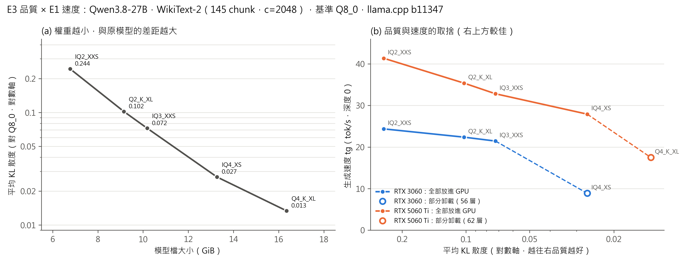
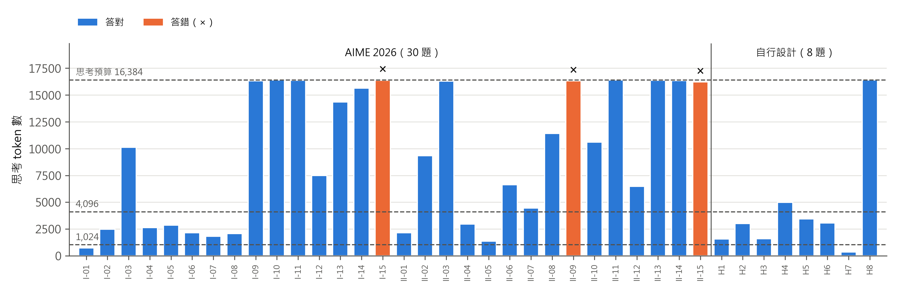
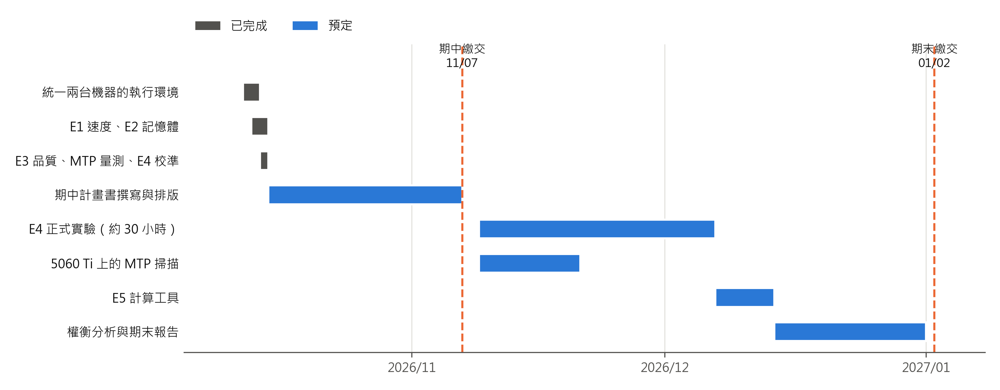

### 2.1.7 品質評估方法（E3）

**困惑度的限制。** 量化研究常以困惑度（perplexity）評估品質 [5]。對一段 N 個 token 的文字，困惑度為 exp(−(1/N) Σ log p(xᵢ))，其中 p(xᵢ) 是模型給「實際出現的下一個 token」的機率；困惑度越低，模型越不意外。困惑度只看正確答案那一個 token 的機率，量化誤差若主要改變其他 token 的機率，困惑度可能幾乎不變，甚至偶然變好。

**KL 散度。** 本研究以 KL 散度為主要指標。做法是先讓高精度的基準模型讀一段文字，保存它在每個位置對整個詞彙表的機率分布 P；再讓量化模型讀同一段文字得到分布 Q，逐位置計算 KL(P‖Q) ＝ Σᵥ P(v) log(P(v)/Q(v))，再對所有位置取平均。KL 散度為 0 代表與基準完全相同，數值越大差距越大。它比較的是整個分布，因此對量化誤差比困惑度敏感。另報告兩個較直觀的指標：**Same top p**（量化模型「機率最高的 token」與基準相同的比例），以及 KL 散度的 99 百分位數（反映少數嚴重偏差的位置）。

**資料與基準。** 資料集為 WikiText-2 [7] 的原始測試集，共 297,193 個 token，以每段 2,048 token 切成 145 段，全部使用。基準為 Q8_0（8.51 位元），因 27 GiB 放不進 16GB 卡而以部分卸載執行；理想上應使用 16 位元原始權重，這是本研究的限制之一。由於詞彙量達 248,320，基準檔每個 token 約佔 0.5 MB，全部 145 段約 74 GB。正式執行前先以 4 段試跑，量出檔案大小（2.03 GB）與時間（23 秒），確認磁碟空間足夠後才進行；正式執行時基準約 7.4 分鐘，每種量化約 6 分鐘。KL 散度與硬體無關，因此只在主力機上執行。

**表 10　品質評估結果（實測，WikiText-2 全部 145 段；基準 Q8_0 的困惑度為 6.3541 ± 0.0406）**

| 量化 | 檔案大小 | 困惑度 | 困惑度比（量化／基準） | 平均 KL 散度 | KL 散度中位數 | KL 散度 99% | Same top p |
|---|---|---|---|---|---|---|---|
| UD-IQ2_XXS | 6.77 GiB | 7.546 ± 0.049 | 1.188 | 0.2442 | 0.1103 | 2.372 | 79.7% |
| UD-Q2_K_XL | 9.15 GiB | 6.657 ± 0.042 | 1.048 | 0.1020 | 0.0359 | 1.052 | 87.5% |
| UD-IQ3_XXS | 10.18 GiB | 6.568 ± 0.042 | 1.034 | 0.0725 | 0.0237 | 0.720 | 89.5% |
| UD-IQ4_XS | 13.27 GiB | 6.351 ± 0.040 | 1.000 | 0.0267 | 0.0070 | 0.236 | 94.1% |
| UD-Q4_K_XL | 16.35 GiB | 6.344 ± 0.040 | 0.999 | 0.0134 | 0.0026 | 0.091 | 96.4% |

**初步發現（RQ1）。**

1. **困惑度分辨不出 4 位元附近的量化，KL 散度可以。** IQ4_XS 與 Q4_K_XL 的困惑度和基準在誤差範圍內相同（困惑度比 1.000 與 0.999），但平均 KL 散度相差一倍（0.0267 與 0.0134），99 百分位數相差 2.6 倍。這支持本研究以 KL 散度為主要品質指標的選擇
2. **品質隨權重大小平滑變化，沒有斷崖。** KL 散度在對數座標上大致隨檔案大小線性下降（圖 5 左）；IQ2_XXS 約每 5 個 token 就有 1 個的最高機率 token 與基準不同
3. **平均值被少數位置拉高。** 每種量化的 KL 散度中位數都只有平均值的 20～45%，表示多數位置的差異很小，少數位置差異很大。這些「少數位置」是否正好落在推理的關鍵步驟，需由 E4 的任務答對率回答
4. **結合速度（圖 5 右）。** 在「全部放入 GPU」的前提下，16GB 卡的最佳品質選項是 IQ4_XS（27.92 tok/s，KL 散度 0.027），12GB 卡是 IQ3_XXS（21.44 tok/s，0.072）。再往上一級品質雖然更好，但會掉進部分卸載的速度懸崖

KL 散度量的是「逐 token 的分布差異」，與實際任務的答對率不一定成比例；這兩者的關係由 E4 檢驗，也是本研究要回答的問題之一：KL 散度能否預測答對率的下降。

### 2.1.8 推測解碼（MTP）

**原理。** 推測解碼 [10][11] 先由草稿模型一次猜出數個 token，再由主模型一次驗證，猜對的直接採用、猜錯的捨棄並由主模型重新產生。因為驗證是一次處理多個 token，類似讀取 prompt，能利用 GPU 的運算能力；猜對越多，生成越快。理論上輸出分布與不用推測解碼時相同 [11]。本研究的草稿模型是模型本身附帶的 MTP 層 [12]，以 llama.cpp 的 `draft-mtp` 模式使用。參數 `n_max` 是每次最多猜幾個 token；**接受率**是猜出的 token 中被主模型採用的比例。

**為什麼放進 RQ2。** MTP 本身佔用 VRAM，而 VRAM 原本可以拿來放 context。它換來的是速度，速度又決定同樣時間內能思考多少（RQ3）。因此 MTP 是 VRAM 分配的第三個選項。

**VRAM 代價（實測）。** 表 11 是 5060 Ti 上以 IQ4_XS、context 16,384、n_max = 3 啟動時，開與不開 MTP 的記憶體組成。開啟 MTP 共多出 1,736 MiB（log 各項加總；nvidia-smi 為 13,754 → 約 15,500 MiB），依 2.1.5 的模型約等於 4.5 萬 token 的 context（推導值）。

**表 11　開啟 MTP 時的 GPU 記憶體組成（實測，MiB，5060 Ti、IQ4_XS、context 16,384、n_max = 3）**

| 項目 | 不開 MTP | 開 MTP | 差異 |
|---|---|---|---|
| 主模型權重 | 12,726.35 | 13,061.10 | ＋334.75 |
| 主模型 KV cache | 544.00 | 544.00 | 0 |
| 遞迴狀態 | 149.62 | 598.50 | ＋448.88（4 倍） |
| 主模型運算暫存 | 160.28 | 160.28 | 0 |
| 草稿模型權重 | — | 774.71 | ＋774.71 |
| 草稿模型 KV cache（16 位元） | — | 64.00 | ＋64.00 |
| 草稿模型運算暫存 | — | 114.02 | ＋114.02 |
| 合計 | 13,580.25 | 15,316.61 | ＋1,736.36 |

主模型權重多出的 334.75 MiB，推測是開啟 MTP 後，主模型檔中原本被略過的 MTP 層也被載入（未確認）。最值得注意的是遞迴狀態變成 4 倍。為了確認原因，本研究在 3060 上以 Q2_K_XL 掃描 n_max（表 12）：遞迴狀態剛好等於 149.62 MiB ×（1 ＋ n_max），n_max = 1、2、3、4、6 時分別為 299.25、448.88、598.50、748.12、1,047.38 MiB，全部吻合。推測是混合架構做推測解碼時，必須為每個草稿位置各保存一份可以退回的遞迴狀態；這是傳統 Transformer 沒有的額外成本。

**表 12　3060 上的 n_max 掃描（實測，Q2_K_XL、context 16,384、關閉思考、每類 2 次；括號內為相對於不開 MTP 的倍數）**

| n_max | 遞迴狀態 | 啟動後 VRAM | 程式碼 tok/s | 數學 tok/s | 中文問答 tok/s | 接受率（程式碼／數學／中文） |
|---|---|---|---|---|---|---|
| 不開 | 149.62 | 9,631 | 22.14 | 22.05 | 22.03 | — |
| 1 | 299.25 | 11,061 | 33.51（1.51） | 33.63（1.53） | **26.38（1.20）** | 0.92／0.93／0.51 |
| 2 | 448.88 | 11,211 | 37.98（1.72） | 39.31（1.78） | 25.84（1.17） | 0.84／0.89／0.41 |
| 3 | 598.50 | 11,361 | 39.62（1.79） | 41.85（1.90） | 22.58（1.02） | 0.79／0.86／0.31 |
| 4 | 748.12 | 11,511 | **40.33（1.82）** | **43.34（1.97）** | 20.61（0.94） | 0.71／0.78／0.24 |
| 6 | 1,047.38 | 11,809 | 第一次推論時記憶體不足而中止 | | | |

另在 5060 Ti 上以 IQ4_XS、n_max = 3 做的初步測試中，程式碼、數學、中文問答分別加速約 2.4、2.6、1.36 倍（每類 2 次）。

**初步發現（RQ2）。**

1. **12GB 卡放不下 IQ3_XXS 加 MTP**（context 16,384 時，在載入草稿模型時配置失敗），必須降到 Q2_K_XL；n_max = 6 時雖能啟動，但第一次推論時記憶體不足而中止
2. **最佳 n_max 取決於內容。** 可預測性高的程式碼與數學，n_max 越大越快，但增幅遞減；開放式的中文問答接受率低（n_max = 4 時只有 24%），猜錯的成本反而讓速度低於不開 MTP。E4 的數學題應使用較大的 n_max
3. **「無損」需要保留說法。** 以 greedy 解碼（temperature 0）比對時，12 組中有 7 組與不開 MTP 時逐字相同（程式碼 4/4、數學 3/4、中文問答 0/4，不同處分別從第 4 到第 304 個字開始）；不開 MTP 重跑則 3 組全部相同，因此差異來自 MTP。推測是驗證時一次處理多個 token，GPU 的運算路徑與加總順序不同，造成極小的數值誤差，在兩個候選機率幾乎相同時改變了選擇；這與文獻「在硬體數值精度內保持分布」的說法一致 [11]。MTP 對答對率的實際影響將由 E4 檢驗

**後續工作。** 在 5060 Ti 上做同樣的 n_max 掃描，並量測開啟思考時的接受率（思考內容的可預測性可能與答案不同）。

### 2.1.9 任務評估設計（E4，對應 RQ3）

**題目。** 共 38 題，以程式批改。其中 **30 題為 AIME 2026**（美國數學邀請賽，答案皆為 0～999 的整數），取自 MathArena [18] 的整理版本；本研究另與第二份獨立整理的資料逐題比對答案，30 題全部一致，並以第三份資料逐字比對題目文字，發現 2 題有抄寫錯誤（其中 1 題漏了撇號，使題意改變），已依官方題目改正並以程式重算答案。另外 **8 題由本研究自行設計**（期望值、數論、組合計數、演算法追蹤、邏輯推理、最短路徑、無線網路計算、程式撰寫各 1 題），答案皆以獨立程式驗證。自行設計的題目不可能出現在模型的訓練資料中，用來對照 AIME 可能的資料汙染。

**批改。** 不使用 LLM 批改 LLM，一律以程式比對（表 13）。模型輸出缺少指定格式即判為錯誤，另統計擷取失敗率。批改程式本身以「用標準答案組成的假回應全部判對、刻意寫錯的反例全部判錯」做自我測試，38 題與 3 個反例全部通過。

**表 13　批改方式**

| 方式 | 適用題型 | 判定規則 |
|---|---|---|
| 整數 | AIME、多數計算題 | 擷取最後一行「答案：」後的整數，與標準答案相等 |
| 文字 | 邏輯推理 | 去除空白、全形轉半形後相等 |
| 分數 | 機率題 | 解析為分數後相等（等值分數皆可） |
| 多欄位 | 「長度＝6，個數＝12」等 | 每個欄位都相等 |
| JSON 欄位 | 資訊擷取 | 解析 JSON 後每個欄位都相等 |
| 程式測試 | 程式撰寫 | 在暫存目錄的獨立子行程中執行測試資料，限時 10 秒，全部通過才算對；禁止使用 eval 等函式 |

**自變數。** 量化 3 種（Q2_K_XL、IQ3_XXS、IQ4_XS）× 思考預算 3 種（1,024、4,096、16,384 token）。預算由推論引擎強制執行，用完即結束思考並開始作答；作答空間另留 4,096 token。context 固定為 32,768。取樣使用模型內建參數，每次都是新的對話，不使用快取。

**設計與統計方法。** 每個條件都回答同一批 38 題，各重複 2 次，屬於**配對設計**。分析方法如下：

1. 每個條件的答對率附 Wilson 95% 信賴區間
2. 兩個條件之間的比較，以同一題、同一次重複在兩邊的對錯配對，使用 McNemar 檢定；答對率差異的信賴區間以配對 bootstrap 估計。配對比獨立比較更容易偵測差異
3. AIME 與自行設計題目分開統計，比較兩者在各條件下的落差，評估資料汙染的影響
4. 以 3 種量化的 KL 散度（2.1.7）與答對率的下降做描述性比較，檢驗 KL 散度能否預測任務表現（只有 3 個點，不做迴歸推論）

**時間指標。** 以串流方式記錄三個時間點：**TTFT**（送出到第一個 token，反映讀取 prompt 的延遲）、**TTA**（送出到開始輸出答案，即使用者實際等待的時間），與總耗時。RQ3 的核心比較是：**在相同的 TTA 下，哪一組（量化 × 預算）答對率最高**，結果將畫成「答對率對平均 TTA」的圖，找出 Pareto 前緣。

**硬體分工。** 答對率與思考 token 數和硬體無關，因此兩台機器分別執行不同的條件以縮短總時間；只放得下 16GB 的條件（IQ4_XS）在主力機執行。各硬體上的 TTA 以 E1 的速度數據（含 context 深度效應）推算，並在 3060 上實測 2～3 個條件驗證推算的準確度。

**難度校準（初步結果）。** 正式實驗前，以 IQ4_XS、預算 16,384 讓 38 題各回答一次（耗時 3.3 小時）：AIME 答對 27/30（90%），自行設計的題目 8/8（100%）。這個條件下接近天花板，單看此條件題目缺乏鑑別力。但思考長度分布很分散（圖 6）：AIME 的思考 token 中位數為 9,718，30 題中只有 10 題在 4,096 token 內自然結束、1 題在 1,024 內結束。因此預算降低時答對率預期明顯下降，RQ3 的差異會出現在不同預算與量化之間。另觀察到，被預算強制結束思考的 10 題中仍有 7 題答對，表示模型常在用完預算前已得到答案，之後的思考是在驗算。答錯的 3 題中，1 題是答案超過當時保留的 2,048 token 作答空間而被截斷，因此正式實驗把作答空間加大為 4,096。

**規模與時間。** 3 種量化 × 3 種預算 × 38 題 × 2 次，共 684 次作答。以校準時每題的實際速度與思考長度推算，IQ4_XS 在 5060 Ti 上每輪 38 題的時間如表 14，合計約 30 小時，排在期中之後執行。

**表 14　每輪 38 題的時間估計（推導值，依校準數據推算，IQ4_XS、5060 Ti）**

| 思考預算 | 每輪時間 | × 2 次 × 3 種量化 |
|---|---|---|
| 1,024 | 0.43 小時 | 2.6 小時 |
| 4,096 | 1.32 小時 | 7.9 小時 |
| 16,384 | 3.32 小時（與校準實測相同） | 19.9 小時 |
| 合計 | | 約 30 小時 |

### 2.1.10 計算工具（E5，對應 RQ4）

**動機。** 初步使用中曾觀察到（使用者先前的對話紀錄，非系統化量測）：問模型「以 150 Mbps 傳輸 10.5 GiB 需要幾秒」，正確答案為 10.5 × 2³⁰ × 8 ÷ (1.5 × 10⁸) ≈ 601.3 秒；模型的推理步驟完全正確，卻把 90,194,313,216 寫成 89,994,313,216，最後答 600。錯誤只出在長數字的算術。

**設計。** 讓模型以函式呼叫的方式使用計算器 [16][17]：模型輸出算式，由評估程式以 Python 計算後把結果回傳給模型，再由模型繼續作答。比較有、無工具時含大數運算題目的答對率，並記錄模型實際呼叫工具的次數與時機。題目包括現有題組中的大數運算題（傳輸時間、無線網路計算等），並另外設計 10～15 題同類題目，答案一律以程式驗證。為了只看工具本身的效果，兩個條件使用相同的量化與思考預算。此實驗排在期末執行。

### 2.1.11 執行進度

| 期間 | 工作 | 狀態 |
|---|---|---|
| 10/12～10/14 | 統一兩台機器環境；E1 速度、E2 記憶體、E3 品質、MTP 量測、E4 難度校準 | 已完成 |
| 10/15～11/06 | 期中計畫書撰寫、排版 | 進行中 |
| 11/07 | 期中計畫書繳交 | |
| 11/09～12/06 | E4 正式實驗（約 30 小時，兩台機器分工）；5060 Ti 上的 MTP 掃描 | |
| 12/07～12/13 | E5 計算工具實驗 | |
| 12/14～12/31 | 權衡分析、部署建議、期末報告撰寫；時間允許則進行延伸實驗 | |
| 2027/01/02 | 期末報告繳交 | |

### 2.1.12 資料管理與可重現性

本研究的每一個實測數字，都能追溯到一份原始紀錄。具體做法如下：

1. **原始輸出完整保存**：推論引擎的啟動紀錄、llama-bench 與 llama-perplexity 的原始輸出、評估程式每一題的完整回應（含思考內容）、每秒的 GPU 紀錄，都依實驗與時間存放
2. **實驗紀錄表**：每次實驗在紀錄表中新增一列，欄位包括機器、GPU、驅動版本、推論引擎 build、映像 digest、模型檔名與 SHA-256、完整指令、時間與備註；失敗的嘗試（例如配置失敗）也照實記錄
3. **腳本化**：所有實驗與分析都由腳本執行（表 15），腳本在啟動時自動記錄環境資訊並計算模型雜湊，長時間實驗在背景執行，中斷後可以接續
4. **版本控制**：腳本、紀錄表、整理後的表格與圖都以 git 管理；模型檔與 74 GB 的基準檔不納入
5. **推導值與實測值分開**：報告中所有推算出來的數值都標明「推導值」

**表 15　實驗與分析腳本**

| 實驗 | 執行腳本 | 分析腳本 | 產出 |
|---|---|---|---|
| E1 速度 | run_e1.sh | analyze_e1.py、plot_e1.py | 速度表、圖 3、圖 4 |
| E2 記憶體 | run_e2.py、parse_server_log.py | analyze_e2.py | 記憶體表、最大 context |
| E3 品質 | run_e3.sh | analyze_e3.py | 品質表、圖 5 |
| MTP | run_mtp.sh、mtp_probe.py | analyze_mtp.py | 掃描表 |
| E4 任務 | run_e4.sh、run_eval.py | run_eval.py（統計） | 每題紀錄、答對率 |
| 題目驗證 | verify_answers.py、verify_aime_2026.py | — | 標準答案的程式驗證 |

### 2.1.13 延伸實驗（若時間允許）

核心實驗以外，以下延伸實驗能進一步回答 RQ2，將視時間進行。它們都使用既有的腳本與資料，不需要新的硬體。

**表 16　延伸實驗**

| 代號 | 內容 | 預期價值 |
|---|---|---|
| X1 長文件情境 | 以程式產生 16K～64K token 的長文件檢索題（長度可控、可程式批改），比較不同 context 設定 | 讓「context 容量」在權衡中真正被考驗 |
| X2 KV cache 精度 | 16 位元／q8_0／q4_0 三種 KV 精度各算一次 KL 散度；記憶體以公式推導（64／34／18 KiB/token） | 若 q4_0 品質損失很小，12GB 卡的 context 可再加倍 |
| X3 繁體中文困惑度 | 以一份繁體中文語料計算各量化的困惑度與 KL 散度 | 量化對中文的影響可能與英文不同 |
| X4 網頁搜尋 | 讓模型透過 MCP 使用網頁搜尋，以 10～15 題需要最新資訊的問題比較有、無搜尋的答對率 | 檢驗外部工具能否補足模型知識的時效性 |
